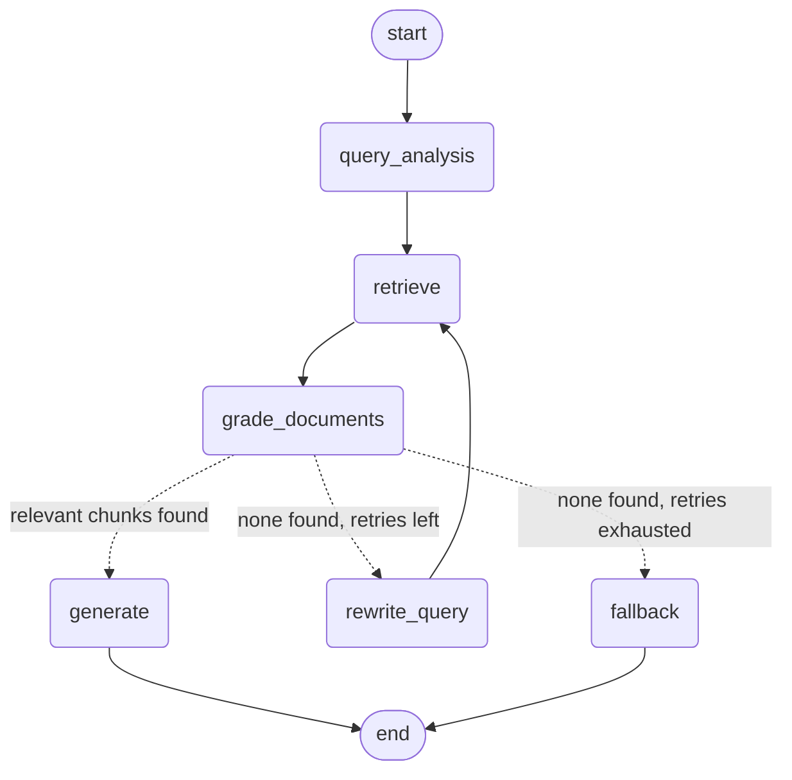

# RAG Technical Documentation Assistant

A Retrieval-Augmented Generation (RAG) system that answers questions about FastAPI documentation.
It uses a **self-corrective LangGraph workflow**: it retrieves chunks, grades them for relevance with an LLM,
rewrites the query and retries if nothing relevant is found, and only then generates an answer with citations.
Served through FastAPI.

## Tech stack

| Part | Choice |
|---|---|
| Workflow | LangGraph `StateGraph` |
| LLM | Groq, `openai/gpt-oss-20b` (configurable via `GROQ_MODEL`) |
| Embeddings | `sentence-transformers/all-MiniLM-L6-v2` (local, free) |
| Vector store | ChromaDB (persistent, local) |
| API | FastAPI + Pydantic |

## Architecture



| Node | What it does |
|---|---|
| `query_analysis` | Classifies the question (conceptual / how-to / troubleshooting / api-reference) and rewrites it into a better search query |
| `retrieve` | Top-5 similarity search in ChromaDB, returning source metadata and distance scores |
| `grade_documents` | Drops chunks that are far from the query, then one LLM call marks each remaining chunk relevant or not |
| `rewrite_query` | Writes a new query from a different angle, told which queries already failed. Increments `retry_count` |
| `generate` | Answers using only the relevant chunks, with numbered citations |
| `fallback` | Returns "I couldn't find relevant information" with no sources |

**Conditional edge** (after grading): relevant chunks go to `generate`. Otherwise, if `retry_count < 2`, go to `rewrite_query` and loop back to `retrieve`. Otherwise go to `fallback`.

### State schema

| Field | Purpose |
|---|---|
| `question` | The user's original question. **Never modified**, so grading and generation always judge against what was asked |
| `search_query` | The current query used for retrieval (changes on each rewrite) |
| `query_type` | Classification from the analysis node |
| `query_history` | Every query tried. Uses an `operator.add` reducer so each node appends. The rewriter reads it to avoid repeating itself |
| `documents` | Chunks returned by retrieval |
| `relevant_documents` | Chunks that passed grading |
| `retry_count` | Number of rewrites so far. The router compares it to `MAX_RETRIES = 2` |
| `generation`, `sources`, `status` | Final answer, citations, and `answered` / `no_answer` |

## Setup

```bash
git clone https://github.com/Manjushri1234/rag-assistant.git
cd rag-assistant
python -m venv venv
venv\Scripts\activate          # Mac/Linux: source venv/bin/activate
pip install -r requirements.txt
```

Create a `.env` file (see `.env.example`):

```
GROQ_API_KEY=your_key_here
GROQ_MODEL=openai/gpt-oss-20b
```

A free key is available at https://console.groq.com.

## Run

```bash
# 1. Fetch the corpus (optional: the files are already in data/)
python scripts/fetch_corpus.py

# 2. Build the vector index
python -m app.ingestion

# 3. Start the API
uvicorn app.main:app --reload
```

Open http://127.0.0.1:8000/docs for the interactive API page.

Test scripts: `python scripts/test_retrieval.py` and `python scripts/test_graph.py`.

## Corpus

Five pages of the official FastAPI tutorial (a snapshot taken 15 Oct 2026): First Steps, Query Parameters,
Request Body, Handling Errors, Dependencies. They cover conceptual, how-to and troubleshooting questions.
`scripts/fetch_corpus.py` downloads them as Markdown.

## API

| Method | Endpoint | Purpose |
|---|---|---|
| POST | `/query` | Ask a question, get an answer with sources |
| POST | `/ingest` | Upload a `.md`, `.txt` or `.html` file |
| POST | `/ingest/url` | Fetch and index a web page |
| GET | `/documents` | List indexed documents |
| POST | `/feedback` | Thumbs up/down with an optional comment |
| GET | `/health` | Health check |

Status codes: 201 created, 400 empty or non-UTF-8 file, 413 too large, 415 unsupported type,
422 validation error, 502 provider or fetch error, 503 LLM rate limit.

### Example: `POST /query`

Request:
```json
{ "question": "How do I return a 404 error?" }
```
Response:
```json
<<paste your real response from Swagger, including query_id, answer, sources>>
```

### Example: no answer

Request:
```json
{ "question": "Best pasta recipe?" }
```
Response:
```json
<<paste your real response: status "no_answer", retries 2>>
```

### Example: `POST /feedback`

```json
{ "query_id": "<<id from a query>>", "rating": "up", "comment": "helpful" }
```
Response: `{ "status": "recorded" }`

## Ingestion and chunking strategy

Pipeline: load Markdown, clean, split by headings, split by size, embed, store.

- **Cleaning:** removes image links and the "Python 3.x+" tab labels that came from the website.
- **Two-stage splitting:** first by Markdown headings (`#`, `##`, `###`) so a chunk stays inside one topic,
  then a recursive splitter at **800 characters with 120 overlap**, which prefers to break at code fences and paragraphs.
- **Why 800:** `all-MiniLM-L6-v2` reads about 256 tokens (roughly 1000 characters), and code uses more tokens
  per character, so 800 avoids silent truncation.
- **Heading path in the text** (`[Request Body > Use the model]`) helps retrieval and gives readable citations.
- **Deduplication:** the docs repeat the same code example many times, so identical chunks are dropped.
- **Re-ingesting a document replaces its old chunks**, so ingestion is idempotent.
- **Result:** <<106>> chunks across 5 documents.

**Embeddings:** MiniLM, normalized. It is free and local. The tradeoff is that it is weaker than larger models.

## Design decisions and tradeoffs

1. **Original question kept separate from the search query.** Rewrites help retrieval, but the grader and generator
   always see what the user really asked, which prevents drift.
2. **LLM grading is the real filter.** Vector distance is only roughly right: for "How do I make a query parameter
   optional?", the "Required parameters" chunk ranked above "Optional parameters". That is why a grading step exists.
3. **Batched grading (one LLM call for all chunks).** The first version graded each chunk separately and hit Groq's
   free-tier limit (8,000 tokens per minute, HTTP 429). Batching plus `reasoning_effort="low"` fixed it.
4. **Score pre-filter is a safety net, not the main filter.** In testing, every chunk passed the cutoff of 1.4,
   because the query rewriter adds "FastAPI", which pulls even off-topic queries close to the docs.
5. **Citations are verified in code.** Only sources the answer actually cites are returned.
6. **Retry cap of 2** bounds cost and latency. Worst case is 3 retrievals and about 8 LLM calls.
7. **Error handling:** provider rate limits return 503, not 500, because they are not a server bug.
8. **Simple storage:** feedback goes to `feedback.jsonl`, the index to local ChromaDB. Fine for a take-home, not for production.

## Example runs

<<Paste short excerpts from your test_graph.py logs:
- The 404 question: retries 0, KEEP/DROP lines, answer
- The pasta question: three retrievals, then fallback>>

## Known limitations

- **Query rewriting can drift for off-topic questions.** "Best pasta recipe?" was rewritten into
  "FastAPI endpoint for pasta recipes with SQLAlchemy". The grader still rejected everything, so the result was
  correct, but it wasted LLM calls.
- **The generator can add small details not in the sources.** One answer used a `quantity` field that is not in the docs.
  The stricter prompt reduced this but cannot eliminate it.
- **Grading is a bit strict**, so it sometimes drops a useful chunk.
- **`/query` is synchronous**, so a slow question occupies a worker.
- **No authentication, no rate limiting, no delete endpoint.**
- **The 1.4 score cutoff was chosen from only five test queries.**

## What I would improve with more time

1. **Hallucination check node** (Self-RAG style) after generation, verifying every claim is supported.
2. **Off-topic detection** in query analysis, skipping straight to fallback and saving LLM calls.
3. **Evaluation set:** 30 to 50 labeled questions to measure retrieval hit rate, so chunk size, embeddings and
   the score cutoff are tuned on data instead of guesses.
4. **Hybrid search** (BM25 plus vectors) for exact API names, and a reranker.
5. **Conversation memory** for follow-up questions using a LangGraph checkpointer.
6. **Web search fallback** (Tavily) when the corpus has nothing relevant.
7. **Async endpoints, a delete endpoint, and a database for feedback.**

## Assumptions

- English documentation, Markdown-convertible HTML.
- The corpus is small (5 pages), so a local ChromaDB is sufficient.
- A single user or low traffic (free LLM tier).
- Questions are about the indexed docs; anything else should return "no answer".