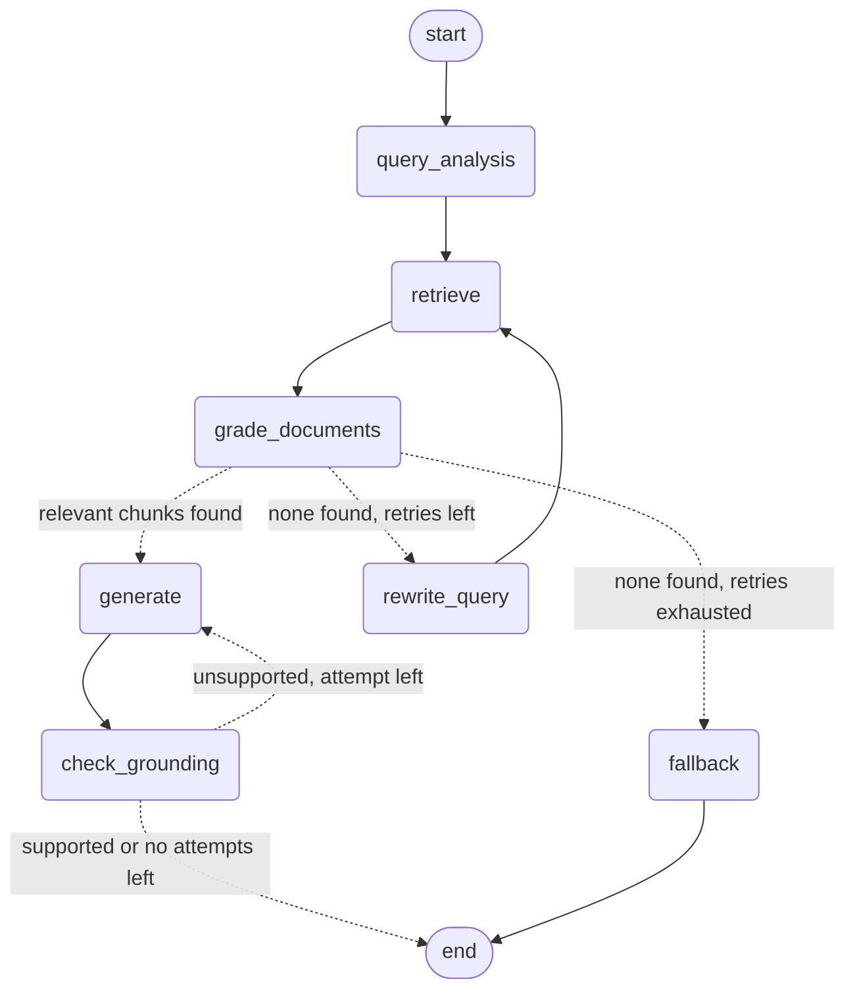

# RAG Technical Documentation Assistant

A Retrieval-Augmented Generation (RAG) system that answers questions about FastAPI documentation.
It uses a **self-corrective LangGraph workflow**: it retrieves chunks, grades them for relevance with an LLM,
rewrites the query and retries if nothing relevant is found, generates an answer with citations, and then
**checks that the answer is actually supported by the retrieved sources** (Self-RAG style hallucination check).
Served through FastAPI.

## Tech stack

| Part | Choice |
|---|---|
| Workflow | LangGraph `StateGraph` |
| LLM | Groq, `openai/gpt-oss-20b` (configurable via `GROQ_MODEL`) |
| Embeddings | `sentence-transformers/all-MiniLM-L6-v2` (local, free) |
| Vector store | ChromaDB (persistent, local) |
| API | FastAPI + Pydantic |

## Architecture



| Node | What it does |
|---|---|
| `query_analysis` | Classifies the question (conceptual / how-to / troubleshooting / api-reference) and rewrites it into a better search query |
| `retrieve` | Top-5 similarity search in ChromaDB, returning source metadata and distance scores |
| `grade_documents` | Drops chunks that are far from the query, then one LLM call marks each remaining chunk relevant or not |
| `rewrite_query` | Writes a new query from a different angle, told which queries already failed. Increments `retry_count` |
| `generate` | Answers using only the relevant chunks, with numbered citations. On a regeneration it is told which claims were unsupported |
| `check_grounding` | Self-RAG style check: an LLM verifies that the answer is supported by the sources. If not, `generate` runs once more with feedback. If it is still unsupported, the answer is returned with `grounding: "unsupported"` and a note |
| `fallback` | Returns "I couldn't find relevant information" with no sources |

**Conditional edges**

1. After grading: relevant chunks go to `generate`. Otherwise, if `retry_count < 2`, go to `rewrite_query` and loop back to `retrieve`. Otherwise go to `fallback`.
2. After the grounding check: an unsupported answer with a regeneration left goes back to `generate`. Everything else ends.

### State schema

| Field | Purpose |
|---|---|
| `question` | The user's original question. **Never modified**, so grading and generation always judge against what was asked |
| `search_query` | The current query used for retrieval (changes on each rewrite) |
| `query_type` | Classification from the analysis node |
| `query_history` | Every query tried. Uses an `operator.add` reducer so each node appends. The rewriter reads it to avoid repeating itself |
| `documents` | Chunks returned by retrieval |
| `relevant_documents` | Chunks that passed grading |
| `retry_count` | Number of query rewrites so far. The router compares it to `MAX_RETRIES = 2` |
| `generation` | The answer text |
| `generation_attempts` | How many times `generate` has run. The router compares it to `MAX_REGENERATIONS = 1` |
| `grounding` | `supported`, `unsupported`, `unverified` (checker output unusable) or `not_applicable` (no answer was generated) |
| `grounding_note` | Which claims were unsupported, if any |
| `sources` | Citations returned to the user |
| `status` | `answered` or `no_answer` |

## Setup

```bash
git clone https://github.com/Manjushri1234/rag-assistant.git
cd rag-assistant
python -m venv venv
venv\Scripts\activate          # Mac/Linux: source venv/bin/activate
pip install -r requirements.txt
```

Create a `.env` file (see `.env.example`):

```
GROQ_API_KEY=your_key_here
GROQ_MODEL=openai/gpt-oss-20b
```

A free key is available at https://console.groq.com. The model name can be changed in `.env`
if Groq renames or retires it (`python -c "from groq import Groq; print([m.id for m in Groq().models.list().data])"` lists current models).

## Run

```bash
# 1. Fetch the corpus (optional: the files are already in data/)
python scripts/fetch_corpus.py

# 2. Build the vector index (required on a fresh clone: chroma_db/ is not committed)
python -m app.ingestion

# 3. Start the API
uvicorn app.main:app --reload
```

Open http://127.0.0.1:8000/docs for the interactive API page.

Test scripts: `python scripts/test_retrieval.py` (retrieval only) and `python scripts/test_graph.py` (full workflow with logs).

## Corpus

Five pages of the official FastAPI tutorial (a snapshot taken 15 Oct 2026): First Steps, Query Parameters,
Request Body, Handling Errors, Dependencies. They cover conceptual, how-to and troubleshooting questions,
and the framework matches the one this project is built with, so answers are easy to judge.
`scripts/fetch_corpus.py` downloads them as Markdown into `data/`, and the files are committed too.

## API

| Method | Endpoint | Purpose |
|---|---|---|
| POST | `/query` | Ask a question, get an answer with sources |
| POST | `/ingest` | Upload a `.md`, `.txt` or `.html` file |
| POST | `/ingest/url` | Fetch and index a web page |
| GET | `/documents` | List indexed documents |
| POST | `/feedback` | Thumbs up/down with an optional comment |
| GET | `/health` | Health check |

Status codes: 200 OK, 201 created, 400 empty or non-UTF-8 file, 413 too large, 415 unsupported file type,
422 validation error, 502 LLM provider error or URL fetch failure, 503 LLM rate limit.

### Example: `POST /query`

Request:
```json
{ "question": "How do I return a 404 error?" }
```

Response (`query_id` is generated per request):
```json
{
  "query_id": "3f9a1c7b2d4e",
  "answer": "To return a 404 error in FastAPI, raise an `HTTPException` with a `status_code` of `404` inside your path operation. For example:\n\n```python\nfrom fastapi import FastAPI, HTTPException\n\napp = FastAPI()\n\nitems = {\"foo\": \"The Foo Wrestlers\"}\n\n@app.get(\"/items/{item_id}\")\nasync def read_item(item_id: str):\n    if item_id not in items:\n        raise HTTPException(status_code=404, detail=\"Item not found\")\n    return {\"item\": items[item_id]}\n```\n\nThis will cause FastAPI to send a 404 response to the client. [3]",
  "status": "answered",
  "sources": [
    {
      "id": 3,
      "doc_name": "handling-errors",
      "section": "Handling Errors > Use `HTTPException` > Import `HTTPException`",
      "source_url": "https://fastapi.tiangolo.com/tutorial/handling-errors/",
      "score": 0.808
    }
  ],
  "query_type": "how-to",
  "retries": 0,
  "queries_tried": ["How to return a 404 error in a FastAPI endpoint?"],
  "grounding": "supported",
  "grounding_note": "",
  "generation_attempts": 1
}
```

Source `id` is the number the answer cites (`[3]`). Only cited sources are returned, so ids may skip numbers.

### Example: no answer

Request:
```json
{ "question": "Best pasta recipe?" }
```

Response:
```json
{
  "query_id": "b81e05d9c6a2",
  "answer": "I couldn't find relevant information about that in the indexed documentation.",
  "status": "no_answer",
  "sources": [],
  "query_type": "how-to",
  "retries": 2,
  "queries_tried": [
    "FastAPI tutorial for building a recipe API endpoint",
    "How to create a RESTful FastAPI endpoint that returns a list of pasta recipes with pagination and filtering by cuisine?",
    "How to implement a FastAPI endpoint that serves a paginated, filterable list of pasta recipes stored in a PostgreSQL database using SQLAlchemy and Pydantic models?"
  ],
  "grounding": "not_applicable",
  "grounding_note": "",
  "generation_attempts": 0
}
```

### Example: `POST /feedback`

Request (use the `query_id` from a query response):
```json
{ "query_id": "3f9a1c7b2d4e", "rating": "up", "comment": "helpful" }
```
Response (`201`):
```json
{ "status": "recorded" }
```

### Example: `POST /ingest/url`

```json
{ "url": "https://fastapi.tiangolo.com/tutorial/query-params-str-validations/", "name": "query-validations" }
```
Returns `201` with `{ "doc_name": "query-validations", "chunks": <n> }`, after which it appears in `GET /documents`.

## Ingestion and chunking strategy

Pipeline: load Markdown, clean, split by headings, split by size, embed, store.

- **Cleaning:** removes image links and the "Python 3.x+" tab labels that came from the website.
- **Two-stage splitting:** first by Markdown headings (`#`, `##`, `###`) so a chunk stays inside one topic,
  then a recursive splitter at **800 characters with 120 overlap**, which prefers to break at code fences and paragraphs.
- **Why 800:** `all-MiniLM-L6-v2` reads about 256 tokens (roughly 1000 characters), and code uses more tokens
  per character, so 800 avoids silent truncation.
- **Heading path in the text** (`[Request Body > Use the model]`) helps retrieval and gives readable citations.
- **Deduplication:** the docs repeat the same code example many times, so identical chunks are dropped.
- **Re-ingesting a document replaces its old chunks**, so ingestion is idempotent.
- **Result:** 106 chunks across 5 documents (dependencies 25, first-steps 27, handling-errors 27, query-params 11, request-body 16).

**Embeddings:** MiniLM, normalized. It is free and local. The tradeoff is that it is weaker than larger models.

**Retrieval sanity check** (`scripts/test_retrieval.py`): for four in-scope questions the correct document ranked first
(distance 0.5 to 1.0), while an off-topic question scored 1.57 or worse. Rankings inside a document were only roughly
right, which is why grading exists.

## Design decisions and tradeoffs

1. **Original question kept separate from the search query.** Rewrites help retrieval, but the grader and generator
   always see what the user really asked, which prevents drift.
2. **LLM grading is the real filter.** Vector distance is only roughly right: for "How do I make a query parameter
   optional?", the "Required parameters" chunk ranked above "Optional parameters". That is why a grading step exists.
3. **Batched grading (one LLM call for all chunks).** The first version graded each chunk separately and hit Groq's
   free-tier limit (8,000 tokens per minute, HTTP 429). Batching plus `reasoning_effort="low"` fixed it.
4. **Score pre-filter is a safety net, not the main filter.** In testing, every chunk passed the cutoff of 1.4,
   because the query rewriter adds "FastAPI", which pulls even off-topic queries close to the docs.
5. **Citations are verified in code.** Only sources the answer actually cites are returned.
6. **Bounded loops.** At most 2 query rewrites and 1 regeneration, so cost and latency are capped.
   A typical answered question takes 4 LLM calls (analysis, grading, generation, grounding check); the worst case is about 10.
7. **Error handling:** provider rate limits return 503, not 500, because they are not a server bug.
8. **Simple storage:** feedback goes to `feedback.jsonl`, the index to local ChromaDB. Fine for a take-home, not for production.
9. **Hallucination check with bounded repair.** After generation, an LLM checks the answer against the retrieved sources.
   An unsupported answer is regenerated once with the unsupported claims listed. It is never silently hidden: if it is
   still unsupported, the API returns it with `grounding: "unsupported"` and the reason, so a client can warn the user.
   Placeholder names in code (for example a made-up `get_item_from_db`) are ignored, otherwise every example would be flagged.
   If the checker's output cannot be parsed, the answer is returned as `unverified` rather than blocked.

## Example runs

Logs from `python scripts/test_graph.py`.

**1. Answered on the first try ("How do I accept JSON data in a POST request?")**
```
[query_analysis] type=how-to | query=FastAPI accept JSON data in POST request body example ...
[retrieve] attempt 1 | 5 chunks
[grade] KEEP | request-body | Request Body
[grade] KEEP | request-body | Request Body > Results
[grade] DROP | first-steps | First Steps > OpenAPI
[grade] 2 of 5 relevant
[generate] attempt 1 | used 2 sources
[grounding] SUPPORTED
STATUS: answered | retries: 0 | generations: 1
```

**2. Correctly declined a question the corpus does not cover ("How do I limit a query parameter to a maximum length of 50 characters?")**

FastAPI supports this (`Query(max_length=50)`), but the five indexed pages do not cover it. The system retried twice,
found nothing relevant, and refused instead of guessing from the model's own knowledge:
```
[grade] 0 of 5 relevant
[rewrite] retry 1 | new query: How can I enforce a maximum string length of 50 on a FastAPI query parameter ...
[grade] 0 of 5 relevant
[rewrite] retry 2 | new query: How can I enforce a maximum length of 50 characters on a FastAPI query string ...
[grade] 0 of 5 relevant
[fallback] no relevant documents after 2 retries
STATUS: no_answer | retries: 2 | generations: 0
```
Ingesting the matching docs page through `/ingest/url` is how a user would fix this gap.

**3. Off-topic question ("Best pasta recipe?")**

All chunks were dropped on all three retrievals, then `[fallback]`, with `status: no_answer` and `grounding: not_applicable`.

**Honest note on the grounding check:** in these runs the checker approved both generated answers, and the other two
questions never reached generation, so the regeneration path (unsupported, then generate again) was not triggered.
It is implemented and bounded, but I did not observe it firing on real data.

## Known limitations

- **Query rewriting can drift for off-topic questions.** "Best pasta recipe?" was rewritten into
  "a FastAPI endpoint for pasta recipes stored in PostgreSQL with SQLAlchemy". The grader still rejected everything,
  so the result was correct, but it wasted LLM calls.
- **The grounding check is itself an LLM**, so it can miss subtle errors or wrongly flag valid ones. It checks the answer
  against the retrieved sources only, not against the real library.
- **Grading is somewhat strict**, so it can drop a useful chunk (for example, in one run it dropped the main
  "Request Body" chunk and kept only a sub-section).
- **Small corpus.** Only five pages, so many reasonable FastAPI questions return "no answer" (see example run 2).
- **`/query` is synchronous**, so a slow question occupies a worker.
- **Free-tier LLM limits.** Heavy use can return 503 (Groq rate limit).
- **No authentication, no rate limiting, no delete endpoint.**
- **The 1.4 score cutoff was chosen from only a handful of test queries.**

## What I would improve with more time

1. **Off-topic detection** in query analysis, skipping straight to fallback and saving LLM calls.
2. **Evaluation set:** 30 to 50 labeled questions to measure retrieval hit rate, grading accuracy and the grounding
   checker (using labelled correct and incorrect answers), so chunk size, embeddings and the score cutoff are tuned on
   data instead of guesses.
3. **Hybrid search** (BM25 plus vectors) for exact API names, and a reranker.
4. **Conversation memory** for follow-up questions using a LangGraph checkpointer.
5. **Web search fallback** (Tavily) when the corpus has nothing relevant.
6. **Async endpoints, a delete endpoint, and a database for feedback.**
7. **Larger or comparison embeddings** (for example `bge-small` or OpenAI) measured on the evaluation set.

## Assumptions

- English documentation, Markdown-convertible HTML.
- The corpus is small (5 pages), so a local ChromaDB is sufficient.
- A single user or low traffic (free LLM tier).
- Questions are about the indexed docs; anything else should return "no answer".
- `query_id` values are not persisted by `/query`; `/feedback` stores whatever id the client sends.